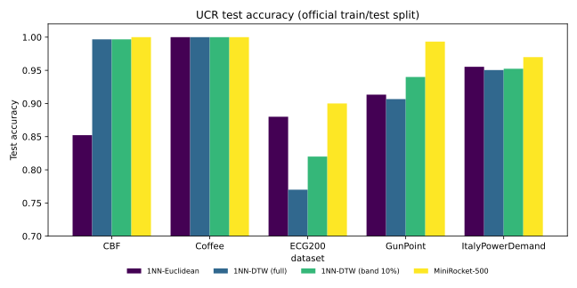

# timeseries-benchmark

A small, reproducible benchmark of time-series **classification** and **clustering** on five public UCR datasets. It compares the classic distance-based methods (Euclidean and DTW 1-nearest-neighbour) with a compact ROCKET-style classifier that I wrote from scratch (random convolutional kernels + ridge regression), and checks how well k-means recovers the true classes under Euclidean and DTW distance.

The point is the comparison and the honest reading of it, not a leaderboard score.

## Results

Test accuracy on the official UCR train/test splits. Series are z-normalised per series. No hyper-parameter tuning on the test set.

| Dataset | 1NN-Euclidean | 1NN-DTW (full) | 1NN-DTW (band 10%) | MiniRocket-500 |
|---|---|---|---|---|
| CBF | 0.852 | 0.997 | 0.997 | 1.000 |
| Coffee | 1.000 | 1.000 | 1.000 | 1.000 |
| ECG200 | 0.880 | 0.770 | 0.820 | 0.900 |
| GunPoint | 0.913 | 0.907 | 0.940 | 0.993 |
| ItalyPowerDemand | 0.955 | 0.950 | 0.952 | 0.970 |



Clustering (k-means with k = number of true classes, train and test merged, adjusted Rand index, mean of 5 seeds):

| Dataset | Euclidean | DTW (barycenter averaging) |
|---|---|---|
| Coffee | 0.41 | 0.54 |
| ECG200 | 0.20 | 0.09 |
| GunPoint | -0.01 | -0.01 |
| ItalyPowerDemand | 0.00 | 0.00 |

Raw numbers, runtimes and standard deviations are in `results/*.csv`.

## What the numbers say (and do not say)

- DTW is not automatically better. It wins by a lot on CBF, where the classes differ by shifts in time, and loses clearly on ECG200 (0.77 vs 0.88 for Euclidean), where alignment is not the useful signal. A 10% Sakoe-Chiba band helps on ECG200 and GunPoint and is 2 to 3 times faster than full DTW.
- The ROCKET-style classifier is the best or tied-best on every dataset here, at a fraction of the DTW cost. With only 500 kernels this is a small version of the method, so treat it as a strong baseline, not a replica of the reference implementation.
- Unsupervised k-means is weak. On GunPoint and ItalyPowerDemand the clusters have almost no agreement with the labels, because the dominant variation in the data is not the class. This is a reason to be careful about claiming clusters are "real" classes.
- Five small datasets and one split each: differences of a few points (for example ItalyPowerDemand) are within noise. I did not run significance tests.
- The accuracies for the Euclidean and DTW baselines on GunPoint, ECG200 and CBF match the values published for these datasets on the UCR archive page, which is a useful sanity check on the pipeline.

## Run it

```bash
pip install -r requirements.txt
python -m tsbench.run      # downloads the datasets, writes results/*.csv (about 2 minutes)
python -m tsbench.plot     # writes results/accuracy.svg
pytest                     # unit tests
```

## Layout

```
tsbench/data.py     download + load UCR datasets
tsbench/rocket.py   MiniRocket-style classifier (numba)
tsbench/run.py      classification and clustering experiments
tsbench/plot.py     accuracy figure
tests/              tests for the loader and the classifier
results/            CSV outputs and figure
```

## Related

I also contribute to [tslearn](https://github.com/tslearn-team/tslearn), the library used for DTW and k-means here.

Data: UCR Time Series Archive, via timeseriesclassification.com. Please cite Dau et al., "The UCR Time Series Archive", 2019, if you use these datasets.
